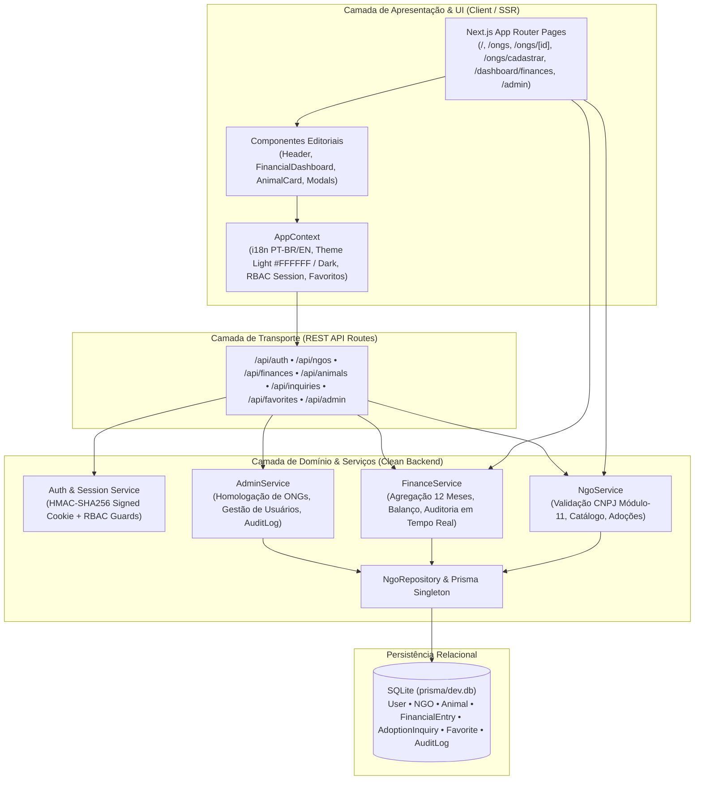

# AdoteAki — Adoção Responsável & Transparência Financeira de ONGs

**AdoteAki** é uma aplicação web Full-Stack de produção construída com **Next.js 14 (App Router)**, **TypeScript**, **Tailwind CSS** e **SQLite (via Prisma ORM)**, desenhada sob princípios estritos de **Clean Architecture** para conectar cidadãos a organizações brasileiras de proteção animal verificadas e auditar em tempo real a execução orçamentária de cada abrigo.

---

## 1. Arquitetura do Sistema (Clean Architecture)

A aplicação separa rigorosamente a camada de apresentação e estado de cliente (`src/components`, `src/context`, `src/app`) da camada de regras de negócio, autenticação RBAC e persistência de dados (`src/server/services`, `src/server/repositories`, `src/server/auth`, `src/server/db`).



### Estrutura de Diretórios

```text
├── prisma/
│   ├── schema.prisma          # Modelagem relacional SQLite (7 modelos)
│   └── seed.ts                # Seed de ONGs brasileiras, animais e 12 meses de contabilidade
├── src/
│   ├── app/                   # Rotas App Router e Endpoints REST (/api/*)
│   │   ├── api/               # Backend Controllers (auth, ngos, finances, animals, inquiries, favorites, admin)
│   │   ├── admin/             # Portal de Governança e Log de Auditoria (ADMIN)
│   │   ├── dashboard/finances/# Gerenciador Financeiro e Operacional em Tempo Real (NGO / ADMIN)
│   │   ├── ongs/              # Diretório Nacional (/ongs), Perfil (/ongs/[id]) e Cadastro (/ongs/cadastrar)
│   │   └── page.tsx           # Landing Page ("Quem Somos", "Nosso Objetivo", Métricas e Destaques)
│   ├── components/            # Componentes modulares de UI (Zero AI-template vibe)
│   ├── context/               # Contexto global (i18n PT-BR/EN, Light/Dark Theme, Sessão RBAC)
│   ├── lib/                   # Dicionários i18n e validadores (CNPJ Módulo-11, Moeda BRL, Telefone)
│   └── server/                # Camada de Backend isolada (db, auth, repositories, services)
```

---

## 2. Perfis de Acesso (RBAC) e Credenciais de Demonstração

O cabeçalho global possui um **Alternador Rápido de Perfil (1-Clique)** além do modal completo de Login/Cadastro para facilitar a avaliação imediata dos 3 perfis:

| Perfil | E-mail | Senha | Permissões Principais |
| :--- | :--- | :--- | :--- |
| **1. Administrador (`ADMIN`)** | `admin@adoteaki.org.br` | `admin123` | Aprovar/suspender ONGs, gerenciar usuários globais, auditar relatórios fiscais e inspecionar o Log de Auditoria (`/admin`). |
| **2. Gestor de ONG (`NGO`)** | `contato@pataspaulistas.org.br` | `ong123` | CRUD em tempo real do Livro-Razão financeiro (`/dashboard/finances`), gestão do catálogo de animais, avaliação de pedidos de adoção e edição do perfil público. |
| **3. Apoiador / Público (`SUPPORTER`)** | `apoiador@adoteaki.org.br` | `apoiador123` | Busca avançada de ONGs e animais, favoritar animais, enviar pedidos de adoção e auditar balanços financeiros públicos. |

---

## 3. Configuração de Variáveis de Ambiente

Crie um arquivo `.env` na raiz do projeto (ou copie de `.env.example`):

```bash
cp .env.example .env
```

Conteúdo padrão do `.env`:

```env
DATABASE_URL="file:./dev.db"
JWT_SECRET="adoteaki-production-secret-key-2026"
NEXT_PUBLIC_APP_URL="http://localhost:3000"
```

---

## 4. Instalação, Migração do Banco de Dados e Seed

```bash
# 1. Instalar dependências
npm install

# 2. Sincronizar schema Prisma com o banco SQLite
npm run db:push

# 3. Popular o banco de dados com ONGs brasileiras, animais e 12 meses de balanços
npm run seed
# (ou via Prisma CLI: npx prisma db seed)

# 4. Iniciar o servidor de desenvolvimento
npm run dev
```

A aplicação estará disponível em `http://localhost:3000`.

---

## 5. Scripts Disponíveis

* `npm run dev` — Inicia o servidor Next.js em modo de desenvolvimento.
* `npm run build` — Gera o cliente Prisma e compila a aplicação para produção.
* `npm run start` — Inicia o servidor de produção após o build.
* `npm run db:push` — Aplica o schema Prisma no arquivo SQLite (`prisma/dev.db`).
* `npm run seed` — Executa `tsx prisma/seed.ts`, recriando as ONGs de São Paulo, Curitiba, Salvador e Belo Horizonte com CNPJs válidos, catálogo de animais e 12 meses de histórico contábil.
* `npm run db:reset` — Reseta completamente o banco SQLite e reaplica o seed inicial.

---

## 6. Verificação e Testes de Funcionalidades

1. **Idioma (PT-BR / EN) & Temas (Light `#FFFFFF` / Dark):**
   * Utilize os botões `PT-BR / EN-US` e o ícone de Sol/Lua no cabeçalho global para alternar instantaneamente o idioma de toda a interface e o tema visual.
2. **Validação de CNPJ e Cadastro de ONG (`/ongs/cadastrar`):**
   * Teste a máscara automática e a validação oficial Módulo-11. Utilize o botão **"Gerar CNPJ Válido"** no formulário para testar um novo credenciamento com configuração financeira inicial automática.
3. **Edição Financeira em Tempo Real (`/dashboard/finances`):**
   * Adicione, edite ou remova lançamentos de receitas/despesas ou altere o Saldo Inicial e observe os gráficos de composição, fluxo de caixa de 12 meses e aviso de última atualização recalcularem imediatamente.
4. **Governança e Auditoria (`/admin`):**
   * Aprove ou suspenda ONGs (como a *Proteção Serra do Curral - MG* inicialmente pendente) e confira o registro imediato na aba **Log de Auditoria da Plataforma**.
